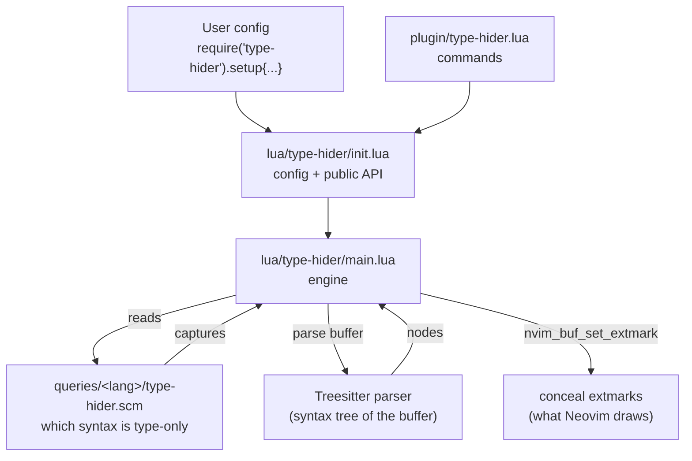
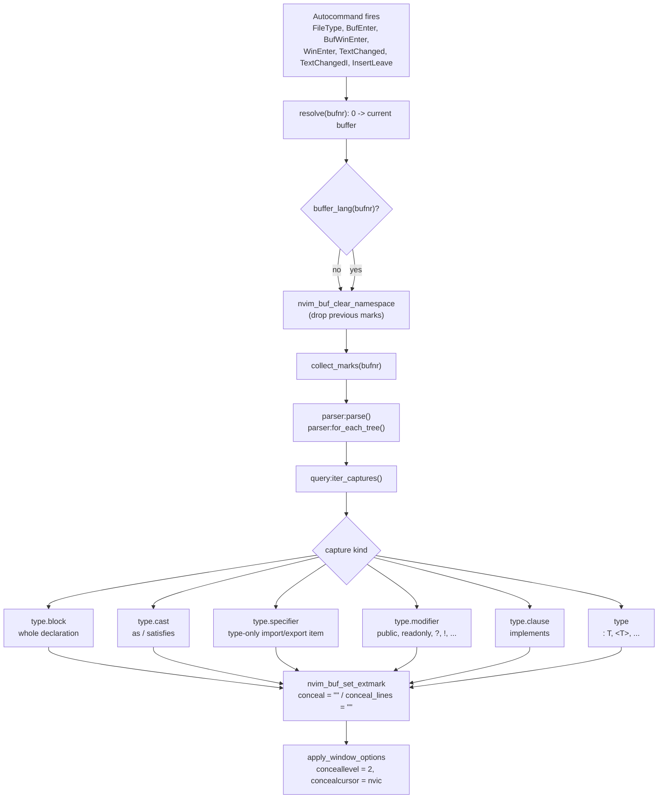
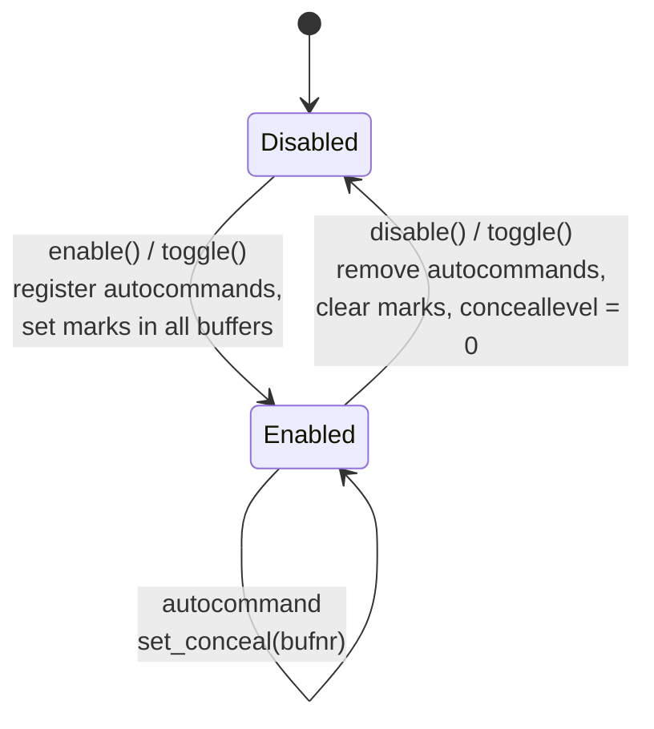
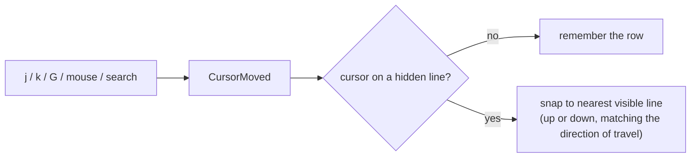

# Architecture

This document explains how _type-hider_ is put together. It is meant for
readers who know TypeScript but are new to Neovim plugin development. The
diagrams are [Mermaid](https://mermaid.js.org/) and render on GitHub.

## The idea in one paragraph

TypeScript type syntax is **not removed** from the buffer. Instead the plugin
asks Treesitter "where is the type syntax?" and then attaches Neovim *extmarks*
with the `conceal` attribute over those ranges. Neovim then draws the buffer
without that text. Because only the *view* changes, everything else (LSP,
diagnostics, `gf`, jumping, editing) keeps working. Showing the types again is
just removing the extmarks.

## Modules

| File | Responsibility |
| --- | --- |
| `plugin/type-hider.lua` | Defines the user commands (`:TypeHiderEnable`, ...). Sourced automatically by Neovim. |
| `lua/type-hider/init.lua` | Default configuration, `setup()`, public API (`enable`/`disable`/`toggle`), and the `.tsx` → `tsx` parser mapping. |
| `lua/type-hider/main.lua` | The engine: autocommands, the Treesitter query run, range computation, the conceal extmarks, and the cursor snapping that skips hidden lines. |
| `queries/typescript/type-hider.scm` | The Treesitter query that selects TypeScript-only syntax. |
| `queries/tsx/type-hider.scm` | Same rules for `.tsx`; it just `inherits: typescript`. |

`type-hider` is a **custom** query name. Neovim has no built-in meaning for it;
the plugin loads it itself with `vim.treesitter.query.get(lang, "type-hider")`.
It is deliberately *not* a `highlights` query, so it never interferes with
syntax highlighting.

## Startup and module overview

Both `setup()` (optional) and the `plugin/` file end up in `init.lua`, which
hands the configuration to the engine and, if `auto_enable` is on, switches the
hiding on.

## What happens per buffer

The engine only acts on buffers whose filetype is configured (`typescript`,
`typescriptreact`). Whenever a relevant event happens it recomputes the marks
for that buffer.

`collect_marks()` turns each capture into a `{ srow, scol, erow, ecol, kind }`
entry. The `kind` decides which extmark attribute is used:

| Capture | Meaning | Extmark |
| --- | --- | --- |
| `@type` | inline type syntax (`: T`, `<T>`, `x is T`, ...) | `conceal = ""` over the node range |
| `@type.block` | whole declaration (`interface`, `enum`, `declare`, overload, ...) | `conceal_lines = ""` if it fills its lines, else `conceal = ""` |
| `@type.cast` | `as` / `satisfies` | `conceal = ""` from the keyword to the node end |
| `@type.specifier` | `import { type A, b }` | `conceal = ""` including the following comma |
| `@type.modifier` | `public`, `readonly`, `override`, `?`, `!`, ... | `conceal = ""` including the trailing space |
| `@type.clause` | `implements A, B` | `conceal = ""` including the leading space |

Two helper behaviours make the result look clean:

* A `@type.block` that spans full lines also hides **one following blank line**,
  so folded declarations do not leave a growing gap of empty lines.
* Modifier/clause ranges swallow the adjacent whitespace so you get `x` instead
  of `   x`.

## Enable / disable lifecycle

* `enable()` registers the autocommands (in the `type-hider-refresh` augroup)
  and immediately conceals every already-open matching buffer.
* `disable()` removes those autocommands, clears our extmark namespace for every
  buffer we touched, and resets `'conceallevel'` to 0. Clearing the extmarks is
  what actually reveals the text again.
* `toggle()` is simply one or the other.

## Cursor behaviour

A hidden line is only hidden *visually*: it still exists in the buffer, so by
default the cursor would stop on every one of them when you press `j`/`k`, and
a folded 20-line declaration would take 20 key presses to get past. To avoid
that, `enable()` also registers a `CursorMoved` autocommand. Whenever the cursor
lands on a hidden line it is pushed to the nearest visible line in the direction
of travel, so moving over a folded declaration feels like moving over a fold.

The hidden line ranges and the last visible row are cached per buffer by
`set_conceal()`, so the check stays cheap. Snapping is skipped in insert mode
while you are typing.

## A few Neovim concepts used here

* **Namespace** (`vim.api.nvim_create_namespace`): extmarks are grouped by a
  namespace id, so `disable()` can wipe exactly our conceal marks and leave
  marks from other plugins alone.
* **Extmark** (`nvim_buf_set_extmark`): an annotation over a buffer range. It
  moves with the text and does not modify the file.
* **`conceal` vs `conceal_lines`**: `conceal = ""` hides the text of the range;
  `conceal_lines = ""` hides the whole lines of the range. Both only apply when
  the window option `'conceallevel'` is at least 2.
* **Window-local options**: `'conceallevel'` and `'concealcursor'` belong to a
  *window*, not to a buffer, which is why the plugin sets them per window. With
  `'concealcursor' = "nvic"` the concealed text also stays hidden while the
  cursor is on the line and while you select with the mouse.
* **Autocommands** (`vim.api.nvim_create_autocmd`): event hooks. The plugin uses
  them to re-hide after edits and when buffers/windows change.
* **Treesitter query** (`.scm`): a pattern language over syntax trees. The query
  only *selects* nodes; the Lua code decides how to hide them.

## Known limits

Details of what is and is not hidden are in the [README](../README.md#what-gets-hidden).
In short: type-only syntax that TypeScript erases is hidden, but runtime
constructs (classes with bodies, `namespace` blocks, decorators) stay visible,
and constructor parameter properties show as plain parameters.
